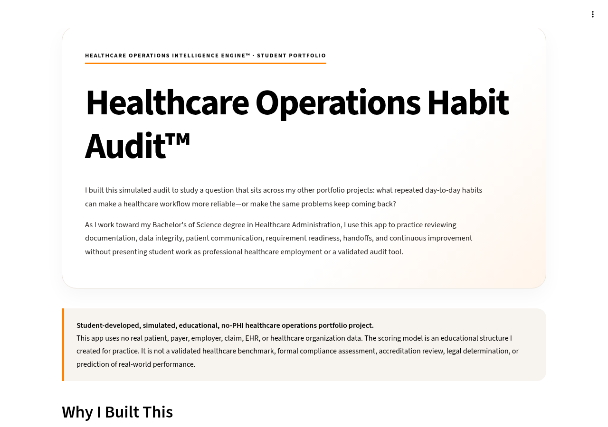
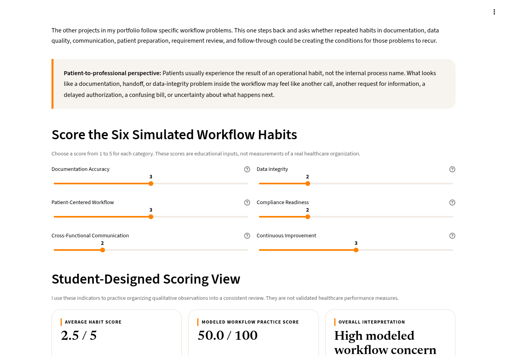
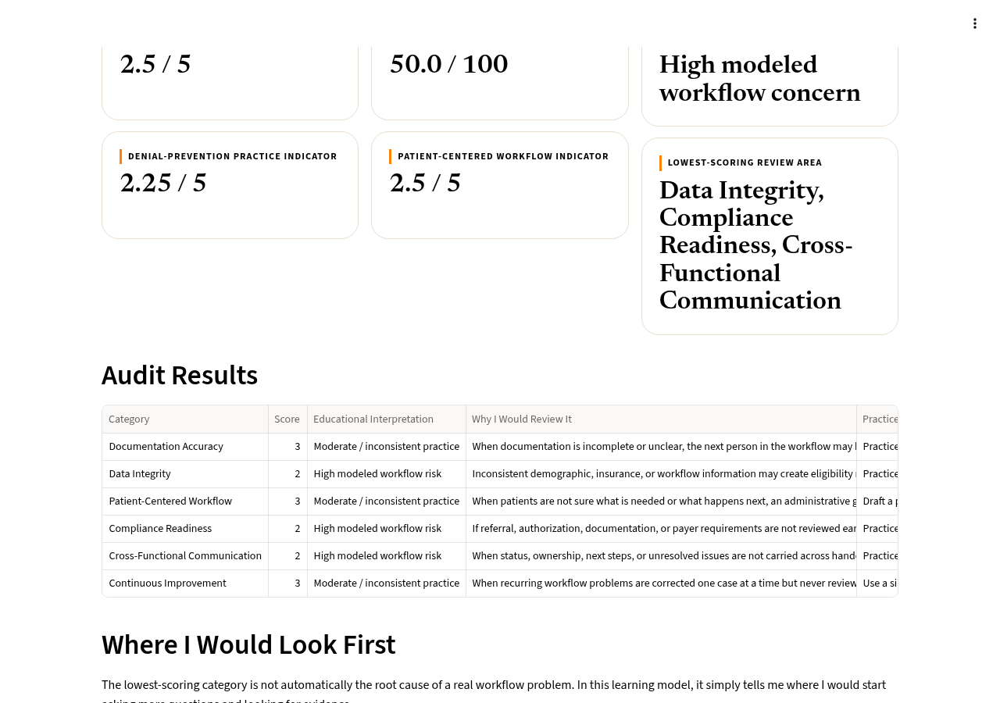
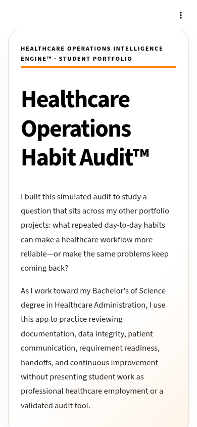

# Healthcare Operations Habit Audit™

**Audit interpretation:** The six habit ratings are fictional subjective learning inputs. Calculated indicators are educational illustrations, not validated organizational audits, compliance findings, or measured improvements. Review EVIS, PARCS, or DPIS for domain-specific queue evidence.

## Recruiter Review — 30-Second Snapshot

**Project type:** Student-developed, simulated, educational, no-PHI; not professional healthcare employment.

- **Operational problem:** Recurring documentation, data-quality, and handoff habits can create repeat operational problems.
- **Student approach:** I built a simulated six-category workflow habit scoring exercise and improvement-plan demonstration.
- **Inspect the evidence:** Interactive educational scoring tool, sample results, screenshots, and 30-day practice plan.
- **Entry-level skills illustrated:** Basic dashboard interpretation, operational documentation, patient-centered thinking, and improvement planning.
- **Assumptions and limitations:** Scores are educational and subjective, not a real organizational audit, validated assessment, or compliance determination.

### Simple Workflow and Handoff View

```text
Select habit → Review example evidence → Assign practice score → Identify improvement → Plan follow-up → Reassess simulated score.
```

**Control question:** Where did the workflow first lose control? Each stage is a hypothetical administrative review step, not a clinical, payer, or compliance authorization.

**Privacy and equity considerations:** All examples are fictional. In actual work, patient identifiers and coverage details require approved access and minimum-necessary handling. Language access, disability accommodations, and timely patient communication may affect safe administrative follow-up; this project does not measure those outcomes.

---


> **Student-developed, simulated, educational, no-PHI healthcare operations portfolio project.**
> Part of the Healthcare Operations Intelligence Engine™ portfolio by Kori Pickle.

I built the Healthcare Operations Habit Audit as a student-developed healthcare operations project to study a broader question than any single eligibility, authorization, or denial case: **what recurring day-to-day habits can make a workflow more reliable—or make the same problems keep coming back?**

As I work toward my Bachelor's of Science degree in Healthcare Administration at the University of Phoenix, I am learning that workflow problems are not always caused by one dramatic failure. Sometimes the risk builds through smaller patterns: information that is not verified consistently, documentation that is not ready for the next step, unclear handoffs, patients who are not sure what they need to do next, or recurring problems that are corrected case by case without being studied as a pattern.

From the patient side, those internal habits can become very visible. They can mean another call, another request for information, a delayed authorization, a confusing bill, a rescheduled visit, or uncertainty about what happens next.

This project gives me a way to practice looking at those patterns across the workflow instead of treating every problem as an isolated event.

## How to View This Project

| Option | Link | What to expect |
|---|---|---|
| **Browser demo (recommended)** | [Open Interactive Demo](https://koripickle1101-tn.github.io/healthcare-operations-habit-audit/demo/) | Runs the same `app.py` in your browser, so there is no server and no sleep screen. First visit downloads about 25 MB and can take 15–30 seconds (longer on slow connections). **This address works only after GitHub Pages is enabled for this repository.** |
| Streamlit Community Cloud app | [Open the Streamlit app](https://healthcare-operations-habit-audit-emd56fbkjuufecaftwypwg.streamlit.app/) | Free hosting sleeps after 12 hours without traffic. If you see “This app has gone to sleep,” click **Yes, get this app back up!** and wait about 30 seconds. |
| Screenshots | [Jump to screenshots](#screenshots) | A no-wait preview of the scoring view and results. |

## Screenshots

All values below are the default **simulated** demo scores. No real organization was assessed.

| Overview | Scoring the six habits |
|---|---|
|  |  |
| **Student-designed indicators and results table** | **Mobile view** |
|  |  |

Screenshots were captured from the Streamlit version of this branch using the default simulated scores. They are stored as SVG files that wrap the original PNG captures.

### 60-second walkthrough
1. Read the disclaimer box. Everything here is simulated and educational.
2. Move any slider (1 = critical modeled weakness, 5 = strong modeled practice).
3. Watch the six indicators recalculate. With the defaults, the average is **2.5 / 5** and the modeled workflow practice score is **50.0 / 100**.
4. Scroll to **Where I Would Look First** to see the lowest-scoring area(s) and the practice action for each.
5. Review the **30-Day Improvement Exercise**, a simulated learning plan.

## Why I Built This Project

I do not have formal healthcare operations employment experience yet, so I use simulated projects to turn coursework and independent study into visible practice.

The other projects in my portfolio follow specific workflow problems:

- **EVIS** looks at eligibility and intake risk.
- **PARCS** looks at prior authorization workflow risk, ownership, and escalation.
- **DPIS** looks at upstream denial-prevention and claim-readiness risk.
- **SBI** asks where the first cross-workflow control loss occurred.

The Habit Audit sits across all of them. It asks a different question:

> **What repeated operational habits may be making workflow risk more likely?**

I built it to practice turning that question into a simple review structure that can be discussed, scored, compared, and connected to improvement ideas.

## What the Audit Reviews

The project uses six simulated review categories:

| Category | What I am reviewing |
|---|---|
| Documentation Accuracy | Whether the information needed for the next step is clear and complete |
| Data Integrity | Whether demographic, insurance, and workflow information is current and internally consistent |
| Patient-Centered Workflow | Whether the patient has clear information about what is needed and what happens next |
| Compliance Readiness | Whether authorization, referral, documentation, and payer requirements appear to have been reviewed before service |
| Cross-Functional Communication | Whether status, ownership, next steps, and unresolved issues are carried across handoffs |
| Continuous Improvement | Whether repeated workflow problems are being tracked and reviewed instead of corrected one case at a time |

**Important boundary:** “Compliance Readiness” is an educational workflow-review label in this project. It is not a legal, regulatory, accreditation, or formal compliance determination.

## How the Scoring Works

Each category is scored from **1 to 5**:

| Score | Educational interpretation |
|---:|---|
| 1 | Critical modeled weakness |
| 2 | High modeled workflow risk |
| 3 | Moderate / inconsistent practice |
| 4 | Mostly reliable modeled practice |
| 5 | Strong modeled practice |

The Streamlit app then calculates several **student-designed indicators** from those inputs.

For example, the default demo scores are:

| Category | Default Demo Score |
|---|---:|
| Documentation Accuracy | 3 |
| Data Integrity | 2 |
| Patient-Centered Workflow | 3 |
| Compliance Readiness | 2 |
| Cross-Functional Communication | 2 |
| Continuous Improvement | 3 |

With those defaults:

- Average habit score = **2.5 / 5**
- Modeled workflow practice score = **50.0 / 100**
- Denial-prevention practice indicator = **2.25 / 5**
- Patient-centered workflow indicator = **2.5 / 5**

These are **not validated healthcare measures or benchmarks**. They are simple educational calculations I created so I could practice turning qualitative workflow observations into a consistent review structure.

## What I Am Practicing

This project helps me practice:

- looking for repeated workflow patterns rather than only one-time errors,
- connecting documentation and data quality to downstream work,
- thinking about patient communication as part of operational reliability,
- reviewing handoffs for ownership and next-step clarity,
- identifying areas that may deserve closer human review,
- creating a simple scoring model,
- translating findings into an improvement plan,
- presenting simulated workflow information in a dashboard,
- and separating educational modeling from real-world performance claims.

## The Patient-to-Professional Connection

One reason this project matters to me is that patients usually experience the **result** of an operational habit, not the internal process name.

A patient may never know that the underlying issue involved data integrity, handoff ownership, documentation readiness, or an unresolved authorization requirement. They may only know that they have to call again, send information again, wait longer, or figure out why the next step did not happen when they expected it to.

That is why I include **Patient-Centered Workflow** as one of the six categories. I want my operational thinking to stay connected to what the workflow feels like from the other side.

## 30-Day Improvement Exercise

The app includes a simulated 30-day improvement plan:

| Timeline | Practice Action | Why I included it |
|---|---|---|
| Week 1 | Review the three lowest-scoring areas | Focus the investigation before trying to change everything at once |
| Week 1 | Build a front-end checklist | Practice standardizing documentation and verification |
| Week 2 | Map workflow handoffs | Look for unclear status, ownership, and next steps |
| Week 2 | Draft a patient next-step script | Practice clearer patient-facing communication |
| Week 3 | Track repeated workflow issues | Look for patterns instead of isolated corrections |
| Week 4 | Review the scores and notes again | Practice continuous-improvement thinking |

This is a learning exercise, not an implementation plan for a real healthcare organization.

## How It Fits in My Portfolio

The Habit Audit is the final cross-cutting project in the workflow path I use across my portfolio:

**EVIS → PARCS → DPIS → SBI → Habit Audit**

The first projects follow particular workflow problems. The Habit Audit steps back and asks whether repeated behaviors in documentation, data integrity, communication, patient preparation, requirement review, and follow-through could be creating the conditions for those problems to recur.

## What This Project Is — and Is Not

This is a **student-developed educational portfolio project**.

- All scenarios, scores, findings, and recommendations are simulated.
- No protected health information (PHI) is used.
- No real patient, payer, employer, claim, EHR, or healthcare organization data is used.
- The scoring model has not been clinically, operationally, legally, or statistically validated.
- The project does not represent a formal compliance assessment, audit, accreditation review, or quality certification.
- It does not represent formal healthcare employment experience.
- It has not been implemented in a healthcare organization.
- I do not claim that it has reduced denials, improved reimbursement, reduced staff workload, improved compliance, or changed patient outcomes.

I want the project to show how I am learning to organize a workflow problem, ask better questions, create a simple review method, and communicate improvement opportunities without overstating what a student project can prove.

## Career Direction

I am building toward entry-level remote work in patient access and healthcare operations, including eligibility verification, prior authorization support, revenue cycle support, denial prevention, documentation workflow support, and related operational roles.

Longer term, I am interested in healthcare operations analysis, workflow improvement, health information systems, analytics, and responsible AI governance in healthcare.

## Connect

- [Healthcare Operations Portfolio Hub](https://healthcare-operations-portfolio-hub.vercel.app/)
- [LinkedIn](https://www.linkedin.com/in/kori-pickle)
- [GitHub profile](https://github.com/koripickle1101-TN)

## Running Locally

```bash
pip install -r requirements.txt
streamlit run app.py
```

To try the browser demo locally, serve the repository root over HTTP (for example `python -m http.server 8000`) and open `http://localhost:8000/demo/`. Opening the file directly will not work because the page fetches `../app.py`.

The browser demo in `demo/index.html` uses [stlite](https://github.com/whitphx/stlite) (Apache-2.0) to run the same `app.py` on Pyodide. Both versions read the brand theme from `.streamlit/config.toml`. The demo fetches `app.py` at load time; there is no duplicated copy.

### Dependency ranges

`requirements.txt` uses compatible ranges (`streamlit>=1.40,<2`, `pandas>=2.2,<4`) instead of exact pins. The newest releases (Streamlit 1.66 / pandas 3.0) require Python 3.11 or newer, and this app's Python version on Streamlit Community Cloud has not been confirmed. The ranges let pip choose versions that match whatever Python the app uses. After confirming the Python version in the app's Cloud settings, exact pins can be added.

Created by Kori Pickle. Student-developed, simulated, educational, no-PHI healthcare operations portfolio project.